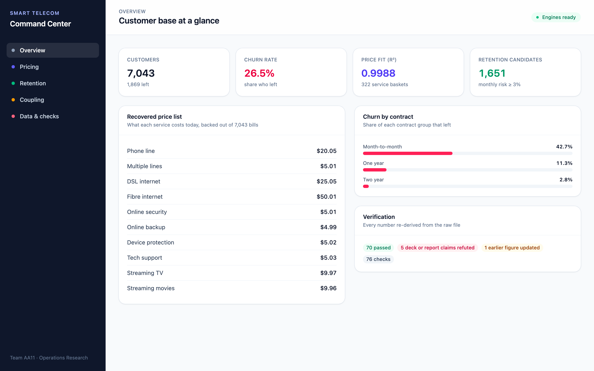
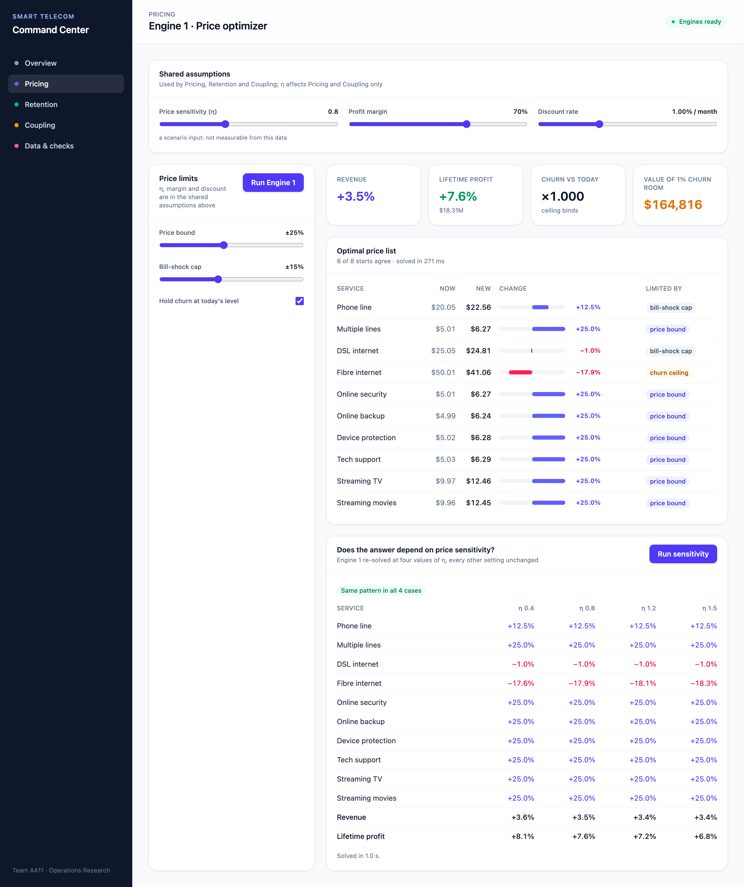
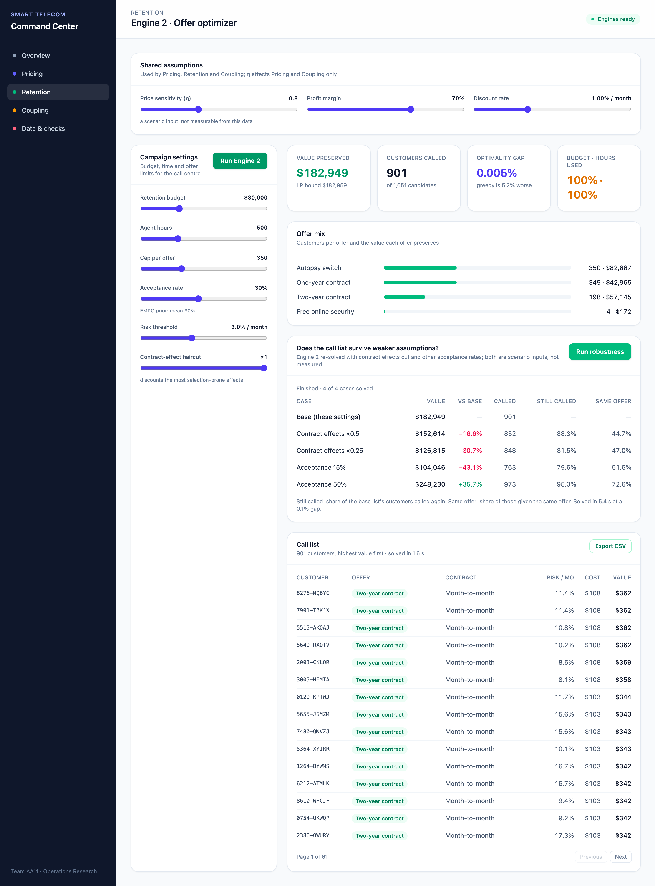
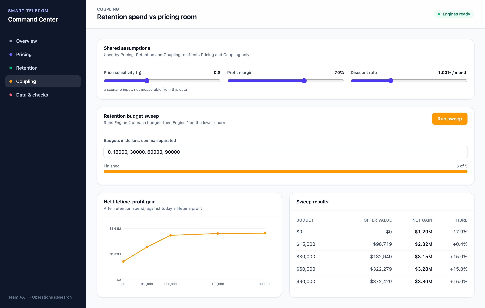

# Chapter: Results (draft)

> Draft for the report. All numbers come from the running app at its default settings and are saved in
> `docs/report/results-data.json` (regenerate with `npm run report:data` while the API runs). Screenshots are in
> `docs/screenshots/` (regenerate with `npm run screenshots`). Default settings: η 0.8, margin 70%, discount 1% per
> month; Engine 2 budget $30,000, 500 agent hours, cap 350 per offer, acceptance 30%, solver gap 0.1%.
> All money figures are **expected values under these stated settings**, not forecasts.

## 1. The customer base

7,043 customers, 26.5% of whom left during their recorded tenure. Month-to-month customers left at 42.7%, one-year
at 11.3%, two-year at 2.8%. The recovered price list explains the bills with R² 0.9988. 1,651 customers have a
monthly churn hazard of at least 3%; they are the retention candidates.

## 2. Engine 1: the price list

| Service | Today | Optimal | Change | Limited by |
| --- | --- | --- | --- | --- |
| Phone line | $20.05 | $22.56 | +12.5% | bill-shock cap (phone + multiple lines) |
| Multiple lines | $5.01 | $6.27 | +25.0% | price bound |
| DSL internet | $25.05 | $24.81 | −1.0% | bill-shock cap (DSL with all add-ons) |
| Fibre internet | $50.01 | $41.06 | −17.9% | churn ceiling |
| Online security | $5.01 | $6.27 | +25.0% | price bound |
| Online backup | $4.99 | $6.24 | +25.0% | price bound |
| Device protection | $5.02 | $6.28 | +25.0% | price bound |
| Tech support | $5.03 | $6.29 | +25.0% | price bound |
| Streaming TV | $9.97 | $12.46 | +25.0% | price bound |
| Streaming movies | $9.96 | $12.45 | +25.0% | price bound |

Revenue rises 3.5% and lifetime profit 7.6% (from $17.01M to $18.31M), with mean churn held exactly at today's level
(ratio 1.000). All 8 solver starts agree.

**Reading the result.** The add-ons rise to their +25% bound and fibre is cut 17.9%. Fibre is the one price limited
by the churn ceiling: the cut is how the optimizer pays for the other increases while keeping mean churn at today's
level. It is not a measured response of fibre customers to price. With the ceiling switched off, every price rises
to the +15% bill-shock limit. The ceiling produces the answer.

**Value of churn room.** Each extra 1% of mean churn the business would accept is worth $164,816 of lifetime profit
(the ceiling's shadow price). This prices the trade-off; it does not recommend relaxing the ceiling.

**Sensitivity to η.** η cannot be measured from this data, so Engine 1 was re-solved at four values:

| η | Fibre | Revenue | Lifetime profit | Pattern |
| --- | --- | --- | --- | --- |
| 0.4 | −17.65% | +3.61% | +8.08% | +U--UUUUUU |
| 0.8 | −17.89% | +3.52% | +7.61% | +U--UUUUUU |
| 1.2 | −18.15% | +3.44% | +7.15% | +U--UUUUUU |
| 1.5 | −18.34% | +3.37% | +6.81% | +U--UUUUUU |

(Pattern: one letter per service in table order; U = at the +25% bound, + / − = moved up / down inside it.)
The *shape* of the price list is the same across the whole range; only the size of the fibre cut and the profit
uplift move. The recommendation does not depend on picking the right η within 0.4-1.5.

## 3. Engine 2: who to call, with which offer

With $30,000, 500 agent hours and at most 350 customers per offer, the integer program calls **901 of the 1,651
candidates** for an expected **$182,949** of preserved lifetime value at 30% acceptance. Budget and hours are both
fully used.

| Offer | Customers | Expected value |
| --- | --- | --- |
| Autopay switch + $25 credit | 350 | $82,667 |
| One-year contract | 349 | $42,965 |
| Two-year contract | 198 | $57,145 |
| Free online security (6 months) | 4 | $172 |

The solution is within 0.0054% of the LP upper bound ($182,959). The best of three greedy rankings is **5.16% worse**,
which is the case for solving the integer program rather than sorting customers by score.

**$182,949 is an expected value**: it assumes 30% of customers accept and that the offer changes a customer's
monthly hazard by the ratio the hazard model associates with that attribute, for the offer's term. Neither was
measured.

## 4. Robustness of the call list

The contract offers rest on the most selection-prone associations, and acceptance is a literature prior. Engine 2
was re-solved four times with everything else unchanged:

| Case | Value | vs base | Called | Still called | Same offer |
| --- | --- | --- | --- | --- | --- |
| Base | $182,949 | — | 901 | — | — |
| Contract effects ×0.5 | $152,614 | −16.6% | 852 | 88.3% | 44.7% |
| Contract effects ×0.25 | $126,815 | −30.7% | 848 | 81.5% | 47.0% |
| Acceptance 15% | $104,046 | −43.1% | 763 | 79.6% | 51.6% |
| Acceptance 50% | $248,230 | +35.7% | 973 | 95.3% | 72.6% |

(App values at a 0.1% solver gap. At 0.01%, as in `verify.py` G9/G10: $152,666, $126,880, $104,046, $248,344, with
the same shares to within a point.)

**Reading the result.** *Who* to call is fairly robust: about 80-95% of the base list is still called in every case. *Which
offer* is not: under weaker contract effects fewer than half keep their offer, as the mix moves from one-year
contracts to two-year contracts and online security. A campaign should treat the call list as the firm output and
the offer assignment as conditional on the contract-effect assumption.

## 5. Coupling: retention spend frees pricing room

| Retention budget | Spent | Offer value | Net gain | Fibre | Phone | Add-ons |
| --- | --- | --- | --- | --- | --- | --- |
| $0 | $0 | $0 | $1.29M | −17.9% | +12.5% | +25% |
| $15,000 | $14,997 | $96,719 | $2.32M | +0.4% | +12.5% | +25% |
| $30,000 | $29,998 | $182,949 | $3.15M | +15.0% | +15.0% | +15.0% |
| $60,000 | $59,925 | $322,279 | $3.28M | +15.0% | +15.0% | +15.0% |
| $90,000 | $89,973 | $372,420 | $3.30M | +15.0% | +15.0% | +15.0% |

Net gain is lifetime profit at the new prices and hazards, minus retention spend, minus today's lifetime profit
($17.01M). The $0 row is Engine 1 alone.

**Reading the result.** Retention spending lowers churn among the customers called, which leaves room under the
churn ceiling to raise prices. At $15,000 the fibre cut disappears; from $30,000 every price reaches the +15%
bill-shock limit and the ceiling no longer binds, so extra budget only adds offer value. Net gain (already after
spend) still rises, but slowly: +$0.13M for the next $30,000 and +$0.03M for the $30,000 after that, against
+$1.03M for the first $15,000 and +$0.83M for the next $15,000.

## 6. Speed

On a MacBook Air (Node 24.12.0, Python 3.14.3): Engine 1 0.27 s, sensitivity (4 solves) 1.05 s, Engine 2 1.6 s,
robustness (5 solves, background job) 5.6 s, coupling sweep of 3 budgets 4.0 s. The API and both Python workers are
ready 1.3-1.5 s after start (about 30-40 s the first time after installing the libraries).
[docs/context/history.md; full timing against the Day 8 budgets still to come]
